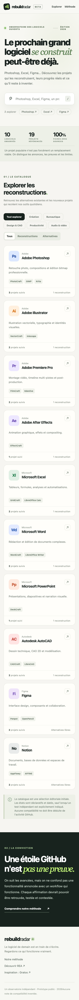

# Rebuild Radar

[](https://github.com/memolabs-dev/rebuild-radar/actions/workflows/ci.yml)
[](LICENSE)

Un observatoire indépendant des **reconstructions de logiciels** et des **alternatives open source** : quelles capacités sont annoncées, documentées, partiellement prises en charge ou encore inconnues ?

> **Statut : MVP / démonstrateur local.** Le dépôt est public, mais aucun site public de production n'est confirmé. Les affirmations de capacité sont un inventaire éditorial, **pas des benchmarks indépendants**. Il n'existe aucun pourcentage de compatibilité vérifié.

## Essayer localement

Prérequis : Node.js 20 ou plus récent. Aucune dépendance externe à installer.

```bash
git clone https://github.com/memolabs-dev/rebuild-radar.git
cd rebuild-radar
npm run check
npm test
npm start
# Ouvrir http://127.0.0.1:3000
```

Le site fournit une recherche, des filtres, des fiches logiciels, une matrice de capacités et un accès aux dépôts sources. Les métadonnées GitHub sont interrogées via une API côté serveur avec allowlist et cache ; les erreurs et limites de l'API peuvent rendre cette activité indisponible. Les favoris sont stockés uniquement dans le navigateur.

## Comprendre les données

- **Reconstruction** : projet cherchant à recréer des comportements d'un logiciel. **Alternative** : produit indépendant couvrant des usages similaires.
- **Déclaré** : capacité annoncée par le projet. **Documenté** : capacité présentée dans sa documentation. **Partiel** : limitations signalées. **Inconnu** : information insuffisante.
- **Vérifié** : réservé à des tests reproductibles avec protocole et artefacts. **Aucune fonctionnalité du catalogue initial n'est actuellement vérifiée indépendamment.**
- Les étoiles, commits et dates GitHub mesurent l'activité, jamais la compatibilité. Un lien de dépôt valide ne vérifie pas les revendications du projet.
- Le champ de date existant est celui de l'inventaire éditorial initial du 16 octobre 2026 ; il ne garantit pas une revue externe récente.

## État de la feuille de route

**MVP présent :** 10 logiciels, catalogue éditorial, moteur de recherche, fiches et API HTTP en lecture seule, tests Node. Les 19 entrées projet référencées dans les données ne sont pas toutes validées individuellement.

**À réaliser :** audit manuel des revendications et licences, navigation de bout en bout en conditions proches de la production, déploiement public, protocole de contribution, observations vérifiables, import contrôlé depuis Mobile Explorer. Voir [roadmap V1](https://github.com/memolabs-dev/rebuild-radar/issues/4).


## Aperçus vérifiés (26 octobre 2026)

Parcours de navigation automatisé testé en navigateur sur ordinateur et à 390 px de largeur mobile : recherche, fiche Excel, matrice de capacités, page Méthode et absence de débordement horizontal. Ces captures ne valident **pas** le déploiement public ni les fonctionnalités des logiciels externes.




[Audit initial des dépôts référencés](docs/SOURCE_AUDIT_2026-10-26.md) · `npm run audit:repositories` pour recontrôler l'accessibilité des dépôts GitHub.

## Pour contribuer

Consultez [CONTRIBUTING.md](CONTRIBUTING.md). Une correction de capacité doit citer sa source et ne doit jamais promouvoir automatiquement un état en « vérifié ».

Documentation : [PRD](docs/PRD.md) · [TRD](docs/TRD.md) · [Fonctionnalités](specs/FEATURES.md) · [Backlog](specs/TASKS.md).

Ce projet n'est affilié ni à Adobe, ni à Microsoft, ni aux autres éditeurs ou projets référencés. Il n'utilise ni ne redistribue leurs actifs propriétaires.

Licence : [MIT](LICENSE) © 2026 Memo Labs.
